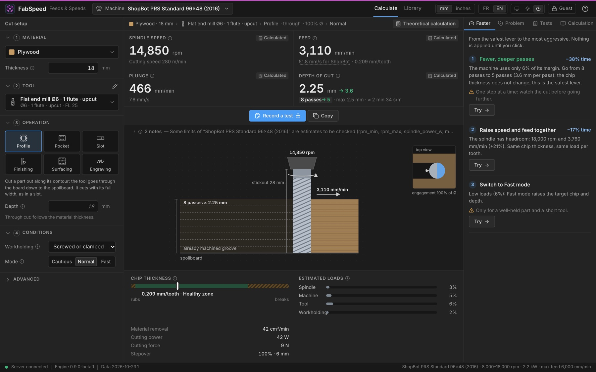
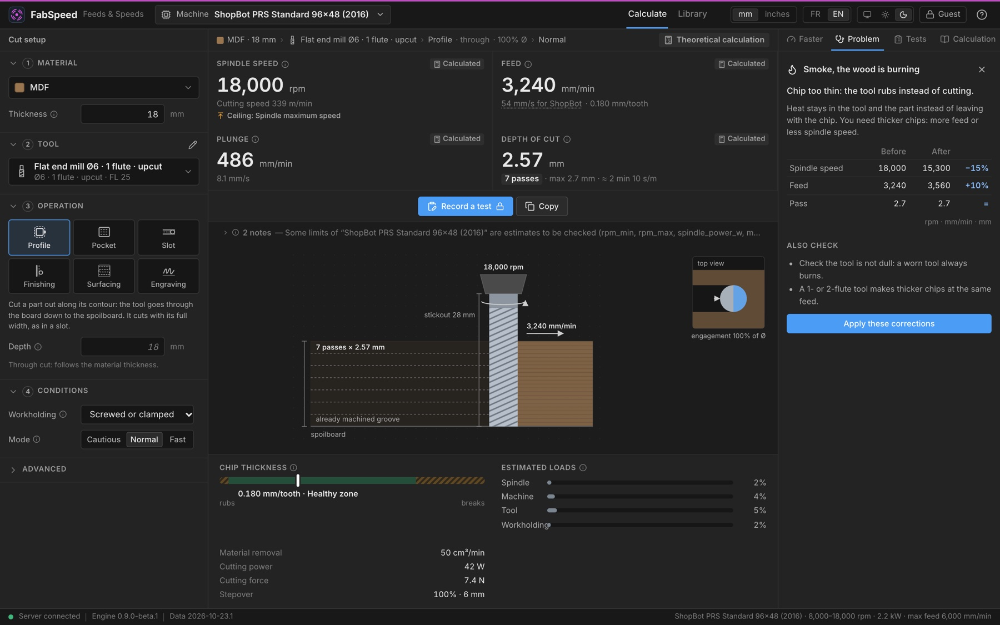
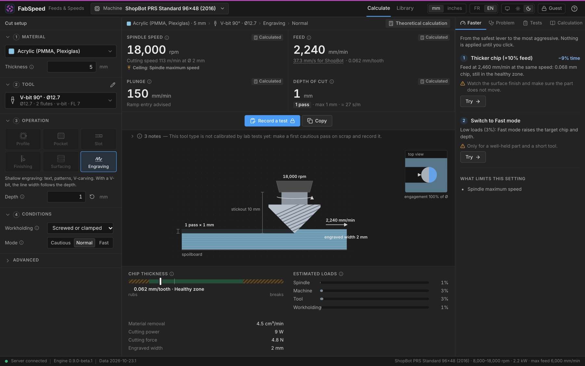
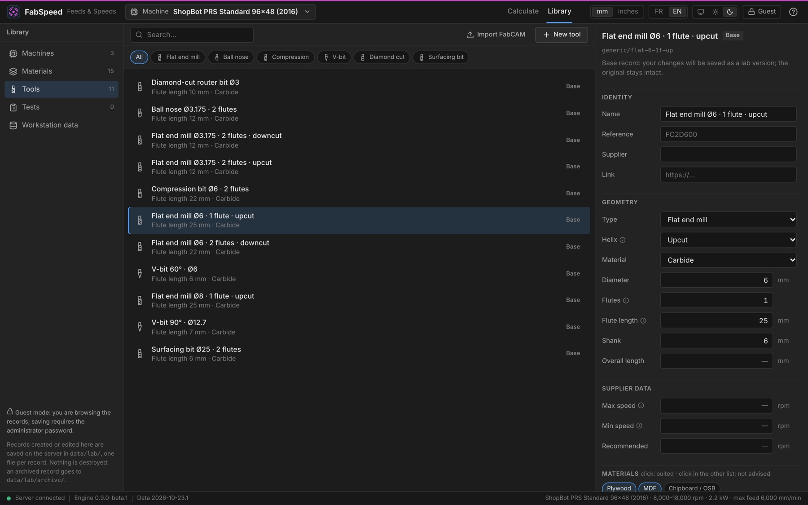
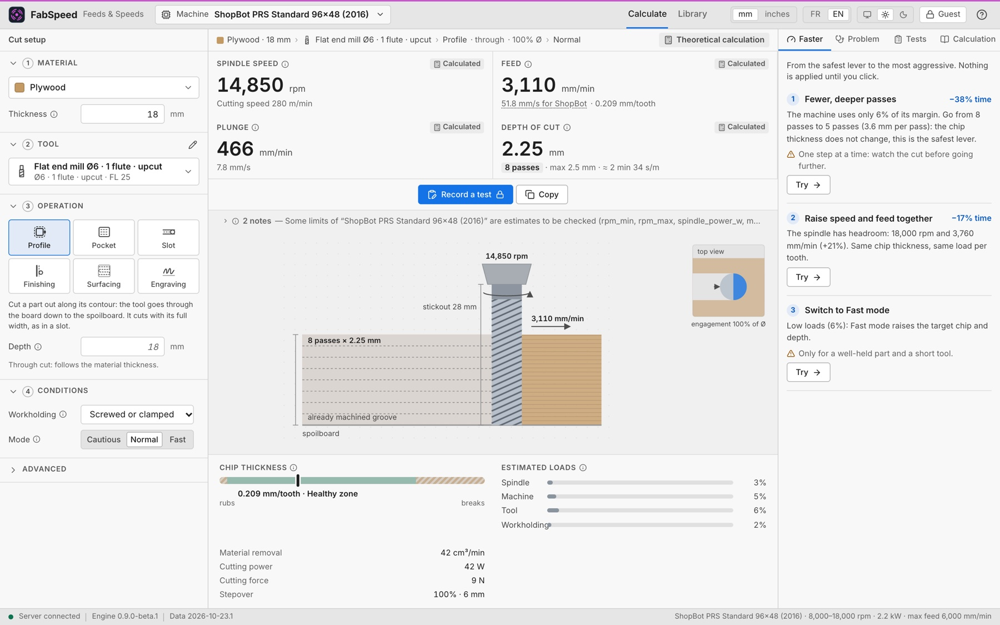

<p align="center"></p>

# FabSpeed

**Feeds & speeds for CNC routers, explained.** [Français](README.fr.md)

FabSpeed proposes cautious starting values for spindle speed, feed, plunge and depth of cut. Choose a machine, material, tool, operation and workholding; inspect the calculation and its provenance before using the values in your CAM software.

**Source preview — version 0.9.0-beta.1.** This repository is an independently initialized source snapshot, not a stable FabSpeed V1 release. No installers or release binaries are published here. See [platform status and build requirements](docs/SOURCE_PUBLICATION.md).



## Features

- A deterministic Rust engine with machine limits, operation context, estimated loads, explanations and explicit manual overrides.
- A scale drawing of the cut, chip-thickness gauge, speed-up suggestions and symptom-based diagnosis.
- A local library of machines, materials and tools, with additive import/export and backup/restore.
- Recorded machining trials; a successful trial can become a tested setting for its exact context. An administrator can validate or revoke it. Software tests and synthetic examples are not physical machining validation.
- Guest and administrator roles; French and English; dark and light themes; millimetres and inches.
- Three machine profiles, 15 materials and 11 generic tool geometries. The shipped model contains no preloaded lab presets. Unconfirmed machine limits remain marked as estimates or “to verify”.

| Diagnosis | V-carving |
| --- | --- |
|  |  |
| Library | Light theme |
|  |  |

## FabApps catalogue

FabSpeed keeps its own engine and local API. An administrator can explicitly approve resources for a versioned local catalogue, from **Library → Local data → FabApps catalogue**. Sharing starts disabled. Local publication was exercised on macOS arm64; **Windows publication is unavailable**, and Linux native publication is not qualified. FabCAM consumption is planned separately; synchronization is not operational. See the [sharing guide](docs/FABAPPS_CATALOGUE_USER_GUIDE.md) and [catalogue contract](docs/fabapps/catalogue/v1/README.md).

## Build from source

Use **Rust 1.88** (pinned), **Node.js 24** with npm, and a native toolchain. Desktop/workspace builds also require the [Tauri platform dependencies](docs/SOURCE_PUBLICATION.md#build-prerequisites). Python 3.12+ and `jsonschema==4.23.0` are used for independent contract checks.

```sh
npm ci --prefix ui
npm --prefix ui run build
cargo run -p fabspeed-server --locked
```

Open <http://127.0.0.1:3030>. The server uses the writable `data/` directory by default; records you create stay under the ignored `data/lab/`. Use `-- --data <your-copy>` for a separate dataset. Back up your data through **Library → Local data**. Keep the server on localhost or a trusted local network: its HTTP transport is not encrypted.

For an embedded-interface server binary, build the frontend first, then:

```sh
cargo build --release -p fabspeed-server --locked
```

Run `target/release/fabspeed` with a writable data directory. For UI development, start the server and run `npm --prefix ui run dev`.

The Tauri desktop application embeds that same server and interface. To compile the workspace without packaging or launching an installer:

```sh
cargo build --workspace --locked
```

Desktop acceptance currently covers **macOS arm64 internal evaluation only**. macOS Intel, Windows and Linux desktop acceptance, distribution signing and macOS notarization remain incomplete. Building successfully does not establish native release qualification.

## Verify

```sh
cargo fmt --all --check
cargo clippy --workspace --all-targets --locked -- -D warnings
cargo test --workspace --locked
npm --prefix ui run check
```

The two optional private calibration functions return without exercising their reference corpus when it is absent. They must be reported as **not run**, not as calibration passes. Public engine tests use synthetic fixtures. See [validation](docs/VALIDATION.md) for the independent JSON schema and publication replay checks.

## Documentation and contributions

- [User guide](docs/USER_GUIDE.md), [calculation model](docs/CALCULATION_MODEL.md), [data format](docs/DATA.md).
- [Architecture](docs/ARCHITECTURE.md), [REST API](docs/API.md), [decision records](docs/adr).
- [Source publication, limitations and future update procedure](docs/SOURCE_PUBLICATION.md).

Report reproducible bugs and propose changes through [issues](https://github.com/harry-finch/FabSpeed/issues) or pull requests. Include the source revision and platform, with a small synthetic reproduction. Never attach passwords, private workshop datasets or supplier documents without redistribution rights. Documentation is primarily in French. Changes to numerical behavior need dedicated review and qualification.

## Safety and licence

These are cautious starting values, not workshop certification. Perform a supervised trial on scrap and follow the machine's operating instructions. Machine metals with appropriate supervision. Entered values are never silently corrected.

Copyright © 2026 Stéphane Muller. FabSpeed code and shipped data are licensed under **[GPL-3.0-or-later](LICENSE)**. Existing third-party rights are retained; see [licensing and attribution](THIRD_PARTY_NOTICES.md). Private lab archives, supplier datasets, real trials and application profiles are excluded.
