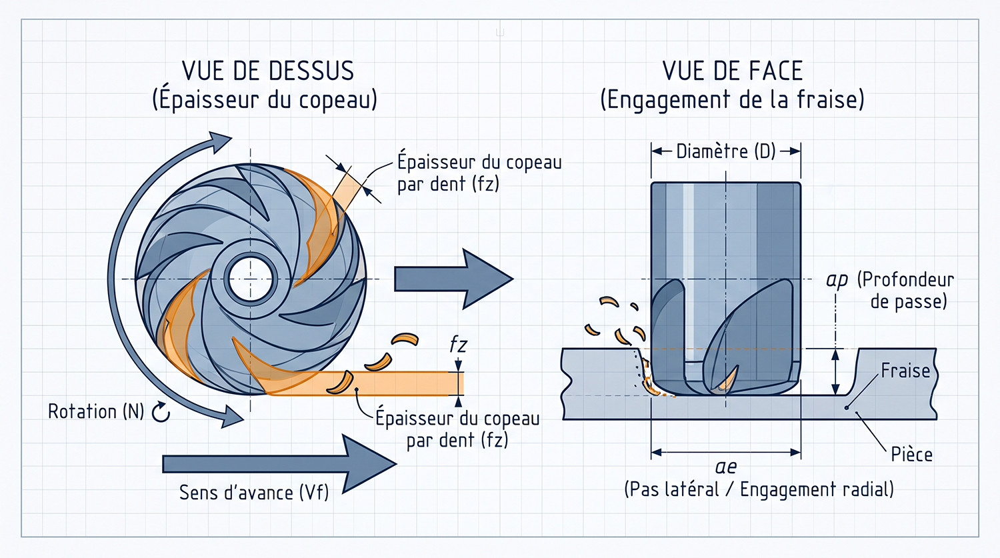
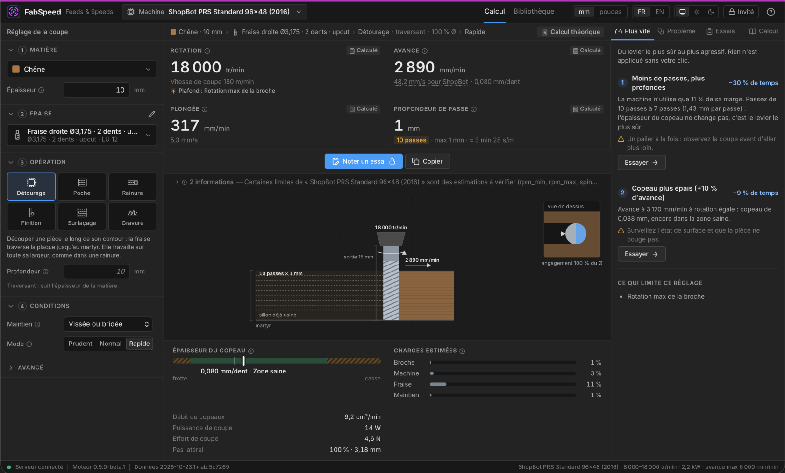

# Paramètres de coupe (feeds and speeds)

> Article de Stéphane Muller, repris du [wiki du FabLab Sorbonne Université](https://wiki.fablab.sorbonne-universite.fr/BookStack/books/machines/page/parametres-de-coupe-feeds-and-speeds), consulté le 14 novembre 2026. Cette copie décrit un contexte et une interface historiques ; pour le comportement actuel, consulter le [modèle de calcul](CALCULATION_MODEL.md) et le [guide utilisateur](USER_GUIDE.md). Les valeurs et exemples ne remplacent pas les consignes de la machine ni un essai supervisé.

> **En bref — Vous êtes devant la machine ?**
> Si votre pièce est bridée et que vous cherchez simplement vos réglages pour préparer votre fichier de FAO, rendez-vous directement à la **[Section 5 : Guide pratique d'utilisation de FabSpeed](#5-comment-utiliser-fabspeed)**. Si vous voulez comprendre pourquoi une fraise brûle le bois ou casse dans l'aluminium, lisez la suite !

---

## 1. Introduction : Le casse-tête des *Feeds & Speeds*

Lorsqu'on prépare un usinage sur une fraiseuse à commande numérique (CNC), dessiner la pièce et choisir une fraise ne représentent que la moitié du travail. Pour générer le programme d'usinage (le G-code) dans un logiciel de FAO, il faut impérativement renseigner **quatre paramètres de coupe** fondamentaux, souvent regroupés sous le terme anglais de ***Feeds and Speeds*** (vitesses et avances) :

- **La vitesse de rotation ($N$)** : la vitesse à laquelle la broche fait tourner la fraise, exprimée en tours par minute (`tr/min` ou `RPM`).
- **La vitesse d'avance ($V_f$)** : la vitesse à laquelle la fraise se déplace horizontalement dans la matière, exprimée en millimètres par minute (`mm/min`) — ou parfois en `mm/s` sur certains contrôleurs comme ShopBot.
- **La vitesse de plongée ($V_p$)** : la vitesse à laquelle la fraise descend verticalement (axe Z) pour entrer dans la matière (`mm/min`).
- **La profondeur de passe ($a_p$ ou *DOC* pour *Depth of Cut*)** : l'épaisseur de matière enlevée à chaque passage successif de la fraise (`mm`), à laquelle s'ajoute **l'engagement latéral ($a_e$ ou *stepover*)** lors d'un évidement de poche ou d'un surfaçage.

### Pourquoi est-ce si critique (et si compliqué) ?

En usinage, contrairement à l'intuition première, **aller plus lentement n'est pas synonyme de prudence**. Tout repose sur un équilibre étroit entre la vitesse de rotation et la vitesse d'avance :

1. **Si vous avancez trop lentement (ou tournez trop vite) :** Les dents de la fraise ne mordent plus la matière, elles **frottent** contre la paroi. Ce frottement génère une chaleur intense qui ne s'évacue pas : le bois noircit et fume, le plastique (PMMA, POM, PEHD) fond et s'agglomère autour de l'outil jusqu'à le casser, l'aluminium se soude aux goujures, et l'arête de coupe de la fraise s'use prématurément.
2. **Si vous avancez trop vite (ou prenez une passe trop profonde) :** Les efforts mécaniques deviennent trop élevés. La fraise fléchit ou casse net, la pièce se décroche de la table, les moteurs de la machine perdent des pas, ou la broche cale.

La difficulté vient du fait qu'il n'existe pas un réglage unique pour « une fraise de 6 mm » ou pour « du contreplaqué ». Le bon réglage dépend simultanément de la matière, du diamètre et du nombre de dents de la fraise, de la rigidité de la machine, du type d'opération (rainure pleine largeur ou contournage léger) et même de la façon dont la pièce est fixée sur la table.

---

## 2. Pourquoi les tableaux des fabricants ne suffisent pas au FabLab

En milieu industriel, le régleur consulte le catalogue du fabricant de la fraise ou un abaque d'usinage. Ces tableaux indiquent des constantes de référence très utiles, mais **appliquer aveuglément ces valeurs dans un FabLab conduit très souvent à l'échec**. Pourquoi ?

- **Des machines radicalement différentes :** Les abaques des outilleurs industriels sont établis sur des centres d'usinage pesant plusieurs tonnes, dotés de bâtis en fonte ultra-rigides et de broches de 10 à 30 kW. Dans un FabLab, on utilise des routeurs à portique (en aluminium ou acier mécano-soudé) ou des fraiseuses de bureau dont la puissance de broche varie de quelques centaines de watts à 2,2 kW, et dont la rigidité latérale est beaucoup plus limitée.
- **Le comportement des broches haute fréquence :** La plupart des broches de routeurs CNC délivrent leur puissance nominale à haut régime (souvent 18 000 ou 24 000 tr/min). À bas régime (par exemple 8 000 tr/min), une broche à couple constant perd proportionnellement sa puissance disponible.
- **Le maintien de la pièce (*Workholding*) :** En industrie, la pièce est serrée dans un étau hydraulique ou sur une table à vide haute pression. Au FabLab, une pièce est parfois vissée dans le martyr, mais souvent tenue par des brides légères, une table aspirante d'atelier, voire du ruban adhésif double-face. Une passe de 6 mm qui fonctionne parfaitement sur une pièce vissée arrachera instantanément une pièce maintenue au double-face.
- **La sortie d'outil (*Stickout*) :** La longueur de fraise qui dépasse de la pince de serrage influence directement sa flexion. Une fraise longue sortie de 40 mm ne peut pas encaisser la même profondeur de passe qu'une fraise courte sortie de 18 mm.

Puisque les tableaux figés ne peuvent pas croiser toutes ces variables, comment fait-on pour calculer des réglages sains en partant de zéro ?

---

## 3. Comment ça se calcule en partant de zéro ?

Choisissez ci-dessous le niveau d'explication qui vous correspond : la **version intuitive (3a)** pour comprendre la logique sans mathématiques, ou la **version ingénierie mécanique (3b)** pour les formules exactes.

### 3a. L'essentiel sans formules (pour tous)

Imaginez que vous vouliez faire des copeaux de chocolat ou de beurre froid avec un couteau, ou raboter une planche de bois :

1. **Tout commence par l'épaisseur du copeau :** Chaque dent de la fraise est comme une petite lame de rabot. À chaque tour, elle doit découper une « tranche » de matière d'une épaisseur bien précise (par exemple `0,05 mm` dans du bois avec une petite fraise).
    - Si la tranche est trop fine (poussière/farine), la lame ne coupe plus : elle frotte, chauffe et brûle.
    - Si la tranche est trop épaisse, la lame se plante dans la matière et casse.
2. **Le copeau emporte la chaleur :** Lorsqu'on coupe à la bonne épaisseur, c'est le copeau éjecté qui embarque avec lui l'essentiel de la chaleur produite par la découpe. Après arrêt complet et refroidissement, vérifiez prudemment la température de la fraise : elle peut rester brûlante. Si vous trouvez de la poussière fine et brûlée au lieu de vrais copeaux, c'est que vous n'avancez pas assez vite par rapport à la vitesse de rotation.
3. **Synchroniser la rotation et l'avance :**
    - Plus la fraise tourne vite ($N$) et plus elle a de dents ($Z$), plus il y a de « coups de couteau » par minute.
    - Pour que chaque dent ait encore une tranche à mordre, il faut donc faire avancer la machine ($V_f$) proportionnellement plus vite. **Une fraise à 3 dents doit avancer 3 fois plus vite qu'une fraise à 1 dent au même régime !**
4. **Choisir la profondeur de passe ($a_p$) selon la force de la machine :** Une fois que l'épaisseur de la tranche est fixée, la profondeur à laquelle vous descendez à chaque tour de piste détermine **l'effort total** demandé à la machine. Si la machine vibre, que la pièce est juste collée au double-face ou que la fraise est très fine, on garde exactement la même vitesse d'avance (pour ne pas brûler), mais on **réduit la profondeur de passe** en faisant plusieurs passages successifs.

### 3b. Le modèle mécanique détaillé (pour les étudiants en mécanique et curieux)

**Cliquer ici pour déplier les équations et le modèle mécanique détaillé**

En ingénierie d'usinage, la détermination analytique des conditions de coupe suit une chaîne cinématique et énergétique précise :

#### 1. Vitesse de coupe (Vc) et fréquence de rotation (N)

Chaque couple outil/matière possède une vitesse tangentielle optimale à la périphérie de l'outil, appelée vitesse de coupe $V_c$ (en $\text{m/min}$). Pour une fraise de diamètre actif $D_c$ (en $\text{mm}$), la vitesse de broche théorique est :

$$N = \frac{1000 \cdot V_c}{\pi \cdot D_c}$$

*Note géométrique :* Pour une fraise droite en contournage, $D_c = D$. En revanche, pour une fraise hémisphérique (*Ball Nose*) engagée sur une faible profondeur $a_p < D/2$, le diamètre qui coupe réellement est réduit :

$$D_c = 2\sqrt{a_p(D - a_p)}$$

De même, pour une fraise à graver en V d'angle de pointe $\alpha$ à une profondeur $p$, le diamètre effectif vaut $D_c = \min\left(D,\; 2 \cdot p \cdot \tan\left(\frac{\alpha}{2}\right)\right)$.

#### 2. Épaisseur de copeau cible (hex) et amincissement radial (Radial Chip Thinning)

Sur les routeurs CNC utilisant des fraises de petit diamètre ($\varnothing 1\text{ à }12\text{ mm}$), l'avance par dent nominale est sensiblement proportionnelle au diamètre de l'outil : $h_{cible} = D \cdot k_{fz}$ (bornée inférieurement par un seuil de non-frottement $f_{z,\min}$ dépendant de l'acuité d'arête et de la matière).

Lorsque l'engagement radial $a_e$ est inférieur au rayon de la fraise ($r = \frac{a_e}{D} < 0{,}5$), l'arc d'engagement se réduit et l'épaisseur maximale réelle du copeau $h_{ex}$ devient plus fine que l'avance par dent programmée $f_z$. Pour maintenir l'épaisseur de copeau réelle à sa valeur cible $h_{cible}$ (et éviter le frottement en finition ou en poche à faible pas latéral), on applique le facteur de compensation d'amincissement radial $k_{RCT}$ :

$$k_{RCT} = \frac{1}{2\sqrt{r - r^2}} \quad \text{avec } r = \frac{a_e}{D} < 0{,}5$$

L'avance par dent programmée vaut alors $f_z = h_{cible} \cdot k_{RCT}$, ce qui donne la vitesse d'avance linéaire (pour $Z$ dents) :

$$V_f = N \cdot Z \cdot f_z$$

#### 3. Débit de copeaux (Q), puissance (Pc) et effort de coupe (Fc)

Le volume de matière enlevé par unité de temps (*Material Removal Rate* ou $MRR$) s'exprime en $\text{cm}^3/\text{min}$ par :

$$Q = \frac{a_p \cdot a_e \cdot V_f}{1000}$$

En utilisant la pression spécifique de coupe de la matière $k_c$ (en $\text{N/mm}^2$), la puissance mécanique requise à l'arête de coupe ($P_c$, en Watts) et la puissance électrique/mécanique demandée à la broche ($P_{broche}$, compte tenu du rendement $\eta$) valent :

$$P_c = \frac{a_p \cdot a_e \cdot V_f \cdot k_c}{60\,000} \quad \text{et} \quad P_{broche} = \frac{P_c}{\eta}$$

On en déduit l'effort tangentiel moyen exercé sur la fraise et la pièce (en Newtons) :

$$F_c = \frac{60\,000 \cdot P_c}{\pi \cdot D_c \cdot N}$$

#### 4. Élancement et déflexion de l'outil

Une fraise se comporte comme une poutre encastrée de diamètre $D$ et de longueur sortie de pince $L$ (*stickout*). Sa flèche en bout d'outil sous l'effort $F_c$ croît avec le cube de la sortie et l'inverse de la puissance quatrième du diamètre ($\delta \propto \frac{F_c \cdot L^3}{E \cdot D^4}$). Au-delà d'un rapport d'élancement critique $\lambda = \frac{L}{D}$ (typiquement $\lambda > 5$), il devient indispensable de pénaliser quadratiquement la profondeur de passe et l'effort admissible par un facteur $(\lambda_{seuil} / \lambda)^2$ pour éviter la rupture en flexion ou le broutement (*chatter*).

---

## 4. FabSpeed : un calculateur pensé pour le FabLab

Pour éviter aux utilisateurs de jongler avec ces formules ou de deviner des valeurs au hasard devant la machine, nous avons développé [**FabSpeed**](https://github.com/harry-finch/FabSpeed), l'outil de recommandation *Feeds & Speeds* du FabLab.

### 4a. La philosophie de FabSpeed

FabSpeed ne se contente pas d'appliquer des formules théoriques dans le vide ; il fonctionne comme un **compagnon d'atelier** qui combine trois niveaux d'intelligence :

1. **La mémoire collective du FabLab d'abord (`Réglage testé / validé`) :** À chaque fois qu'un membre du labo réalise un usinage et enregistre son essai comme « Bon », FabSpeed le mémorise pour cette combinaison exacte (même machine, même matière, même fraise, même opération). Lorsqu'un fabmanager valide cet essai, il devient la **référence officielle du labo**. Si vous préparez exactement la même découpe deux mois plus tard, FabSpeed vous redonnera directement ce réglage éprouvé sur le terrain plutôt qu'un calcul abstrait !
2. **Un filet de sécurité physique pour l'inconnu (`Calculé par le modèle`) :** Si personne n'a encore jamais utilisé cette fraise dans cette matière sur cette machine, FabSpeed calcule un réglage sur-mesure en tenant compte des capacités réelles de la machine choisie, de votre mode de fixation (vis, aspiration, double-face) et de votre intention (**Prudent**, **Normal** ou **Rapide**).
3. **Un système d'alerte et de diagnostic :** Si un essai précédent a échoué avec les réglages que vous vous apprêtez à utiliser, FabSpeed vous avertit immédiatement. Et si, pendant la coupe, la machine fait un mauvais bruit ou que l'état de surface est dégradé, l'assistant **« Que constatez-vous ? »** traduit vos observations visuelles et sonores en corrections chiffrées.

### 4b. Sous le capot du moteur fabspeed-core (pour les profils techniques)

**Cliquer ici pour déplier le fonctionnement de l'algorithme en 6 étapes**

Le cœur de FabSpeed (`fabspeed-core`) est un moteur écrit en Rust, pur, déterministe et sans dépendance d'entrée/sortie, conçu pour être à la fois transparent et explicable. Aucun coefficient empirique n'est caché dans le code : tous les facteurs de correction vivent dans une politique explicite (`policy.toml`) et l'intégralité de la démarche est exposée dans l'onglet **« Comment c'est calculé »** (`TraceStep`).

Voici comment l'algorithme résout une recommandation en 6 étapes :

1. **Résolution géométrique et profondeur cible :** Le moteur détermine d'abord la profondeur de passe nominale ($a_p = D_{ref} \cdot k_{ap}$) modulée par un facteur de réduction pour les petites fraises ($D < 6\text{ mm}$), un bonus si l'engagement radial est faible, le mode choisi, la famille d'outil et la pénalité d'élancement ($L/D$). Il la borne par la longueur utile de coupe (*flute length*) et en déduit le diamètre actif $D_c$.
2. **Calcul de $N$ et plafonnement broche/outil :** La rotation idéale est calculée à partir de $V_c$ (ajustée si l'outil est en acier rapide HSS plutôt qu'en carbure), puis bornée entre `rpm_min` et $\min(\text{rpm\_max}_{machine}, \text{max\_rpm}_{outil})$.
3. **Protection anti-frottement en cas de saturation d'avance :** Le moteur calcule $f_z$ (avec compensation d'amincissement radial $k_{RCT}$ et compensation axiale hémisphérique), puis $V_f = N \cdot Z \cdot f_z$. **Point crucial :** Si l'avance idéale dépasse l'avance maximale de la machine (`max_feed_mm_min`), un calculateur naïf briderait $V_f$ en laissant $N$ à fond, faisant chuter l'épaisseur du copeau dans la zone de frottement. FabSpeed fait l'inverse : il **abaisse automatiquement la vitesse de rotation $N$** pour conserver l'épaisseur de copeau cible $f_z$ !
4. **Confrontation aux « 4 murs physiques » :** Plutôt que de toucher à l'épaisseur du copeau (qui doit rester dans sa zone saine pour couper proprement), FabSpeed évalue la charge induite par la profondeur de passe $a_p$ face à 4 limites physiques pondérées par la cible du mode (`60 %` en Prudent, `80 %` en Normal, `100 %` en Rapide) :
    - **Puissance de broche disponible au régime $N$** (avec déclassement linéaire sous le régime nominal des broches à couple constant).
    - **Rigidité latérale de la machine** (`max_lateral_force_n`, ex. perte de pas ou flexion du portique).
    - **Résistance mécanique de la fraise** ($\propto D^2 \times \text{pénalité d'élancement}$).
    - **Tenue du maintien de pièce** (`400 N` vissé/bridé, `150 N` table aspirante, `60 N` adhésif double-face).

    Si l'un de ces 4 ratios dépasse la cible, $a_p$ est réduite proportionnellement et le facteur limitant est signalé à l'utilisateur.
5. **Égalisation des passes :** Si l'utilisateur a renseigné l'épaisseur totale à découper (ex. `10 mm`) et que la passe maximale autorisée est de `4 mm`, FabSpeed ne fait pas $4 + 4 + 2\text{ mm}$ : il égalise à **3 passes de `3,33 mm`** pour garantir un effort constant du début à la fin.
6. **Génération des leviers par patchs (`RequestPatch`) :** Lorsque les jauges de charge montrent qu'il reste de la réserve, le module `levers` propose des pistes d'accélération classées de la plus sûre (augmenter $a_p$ à copeau constant, puis hausse homothétique $N + V_f$) à la plus agressive, avec estimation du gain de temps en %.

---

## 5. Comment utiliser FabSpeed

Voici la marche à suivre en 4 étapes lors de vos sessions d'usinage au FabLab.

### Étape 1 : Décrire votre contexte d'usinage

Dans le panneau principal de FabSpeed, renseignez les éléments de votre coupe :

1. **Machine & Matière :** Sélectionnez la CNC sur laquelle vous travaillez et le matériau brut. *(Attention : certaines matières comme les métaux affichent un bandeau d'avertissement car leur usinage nécessite obligatoirement la supervision d'un fabmanager)*.
2. **Fraise :** Choisissez une fraise du catalogue du labo (par son nom ou sa référence), ou saisissez les caractéristiques de votre propre fraise (diamètre, nombre de dents, longueur coupante, type d'hélice).
3. **Opération & Profondeur :** Choisissez votre opération (**Détourage / Contour**, **Poche**, **Rainure**, **Finition**, **Surfaçage** ou **Gravure**) et indiquez l'épaisseur de votre plaque ou la profondeur totale à usiner.
4. **Maintien de pièce & Intention :** Précisez comment votre pièce est fixée (**Vissée/bridée**, **Aspiration**, **Double-face**) et choisissez votre mode (**Prudent** pour un premier essai ou une pièce fragile, **Normal** pour l'usage courant).

### Étape 2 : Lire les résultats et reporter les valeurs en FAO

FabSpeed affiche immédiatement les **4 valeurs prêtes à copier** dans votre logiciel de FAO (`Rotation`, `Avance`, `Plongée`, `Profondeur de passe` et le nombre de passes égalisées). Avant de les recopier, vérifiez trois indicateurs visuels :

- **Le badge de provenance :** Il vous indique si les valeurs proviennent d'un **Réglage validé / testé au labo** (haute confiance) ou d'un **Calcul théorique** (auquel cas il est conseillé de faire un premier test sur une chute).
- **La jauge de santé du copeau (`ChipZone`) :** Elle doit être dans le vert (`Ok`). Si vous imposez vos propres valeurs à la main et que la jauge passe en `Frottement` (*Rubbing*) ou `Copeau épais` (*Thick*), corrigez votre saisie avant de lancer la machine !
- **Les 4 jauges de charge physique (`Broche`, `Machine`, `Fraise`, `Maintien`) et les alertes :** Elles montrent quel élément travaille le plus. Si une alerte bloquante apparaît (par exemple *« Fraise trop courte : longueur utile 12 mm pour 18 mm à usiner »*), changez d'outil avant d'aller plus loin.
- **Envie de gagner du temps ?** Si votre usinage est très long et que les jauges de charge sont basses, consultez la section **« Aller plus vite »** : FabSpeed vous propose des boutons d'optimisation classés du plus sûr au plus ambitieux (ex. *« Passer de 4 à 3 passes (-25 % de temps) »* ou *« Rentrer la fraise dans la pince »*) que vous pouvez appliquer en un clic.

### Étape 3 : En cours d'usinage — Utiliser l'assistant « Que constatez-vous ? »

Vous avez lancé la coupe sur une chute, mais quelque chose cloche ? Mettez la machine en pause et ouvrez l'assistant de diagnostic de FabSpeed (`advisor`) :

- Sélectionnez le symptôme que vous observez ou entendez parmi la liste (bruit aigu/strident, vibrations/broutement, bords brûlés, copeaux fondus et collés, arrachement des fibres en surface…).
- FabSpeed vous explique la **cause physique probable** du problème et calcule instantanément un **nouveau jeu de réglages corrigé** (tout en vérifiant que cette correction reste dans les limites de la machine).

### Étape 4 : Après l'usinage — Enregistrer votre essai !

C'est l'étape la plus importante pour la vie du FabLab. Une fois votre coupe terminée, cliquez sur **Enregistrer un essai** (`trials`) :

- Indiquez l'état de la fraise (`Neuve` ou `Usée`) et le résultat de la coupe :
    - **Bon (`Good`) :** La coupe est propre, le bruit était sain, la fraise n'a pas chauffé. Votre réglage devient immédiatement un réglage **Testé** pour toute la communauté du FabLab (et pourra être promu **Validé** par le fabmanager).
    - **À ajuster (`Adjust`) ou Échec (`Failed`) :** Cochez les symptômes observés et ajoutez une petite note. Cet enregistrement est tout aussi précieux : il évitera au prochain utilisateur de refaire la même erreur et de casser une fraise sur le même matériau !
